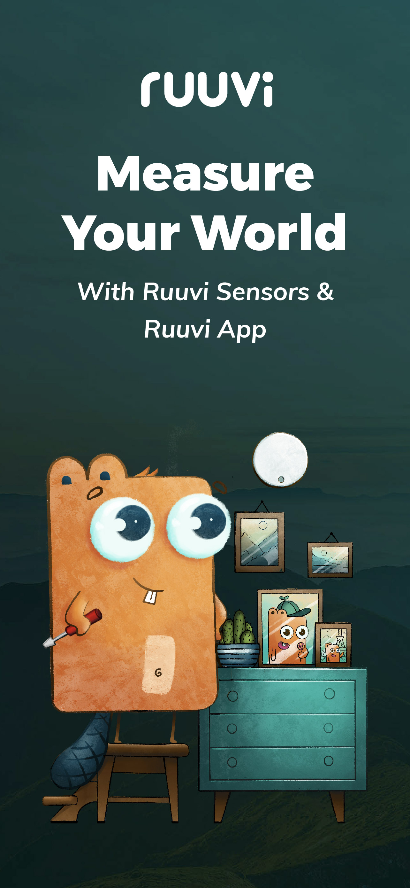
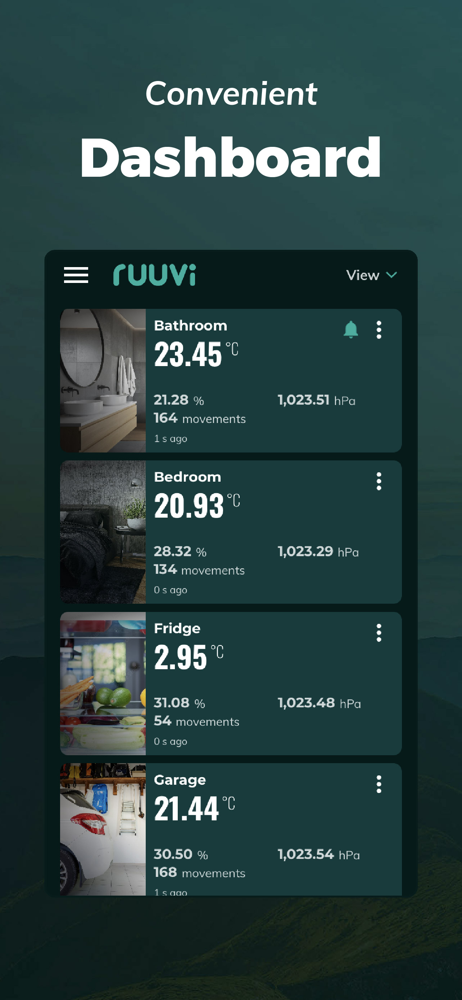
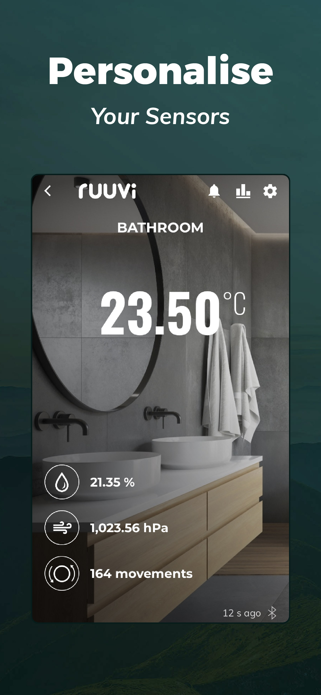
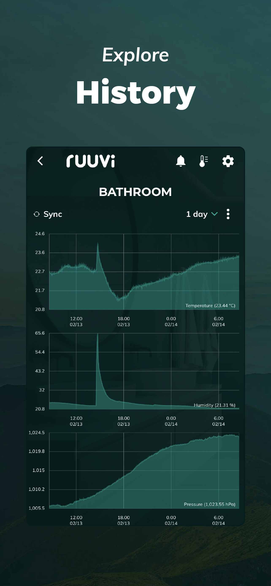
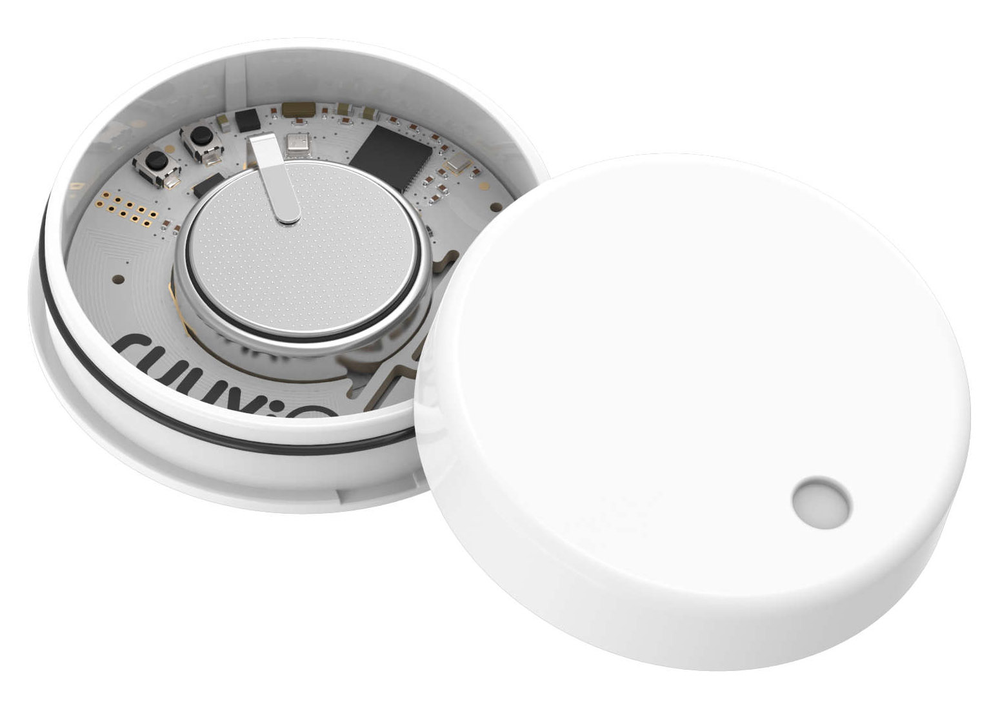
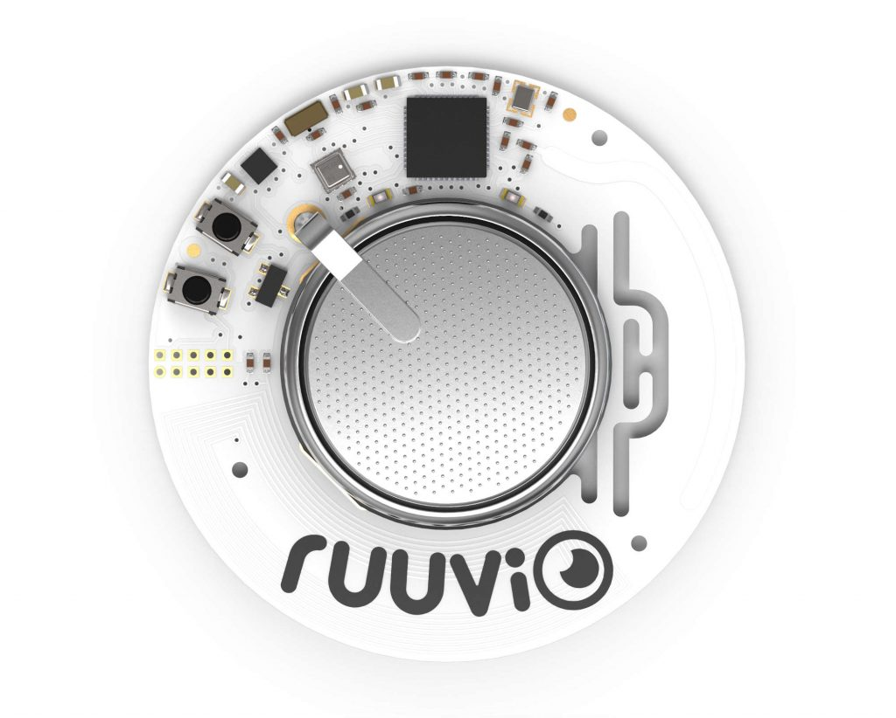
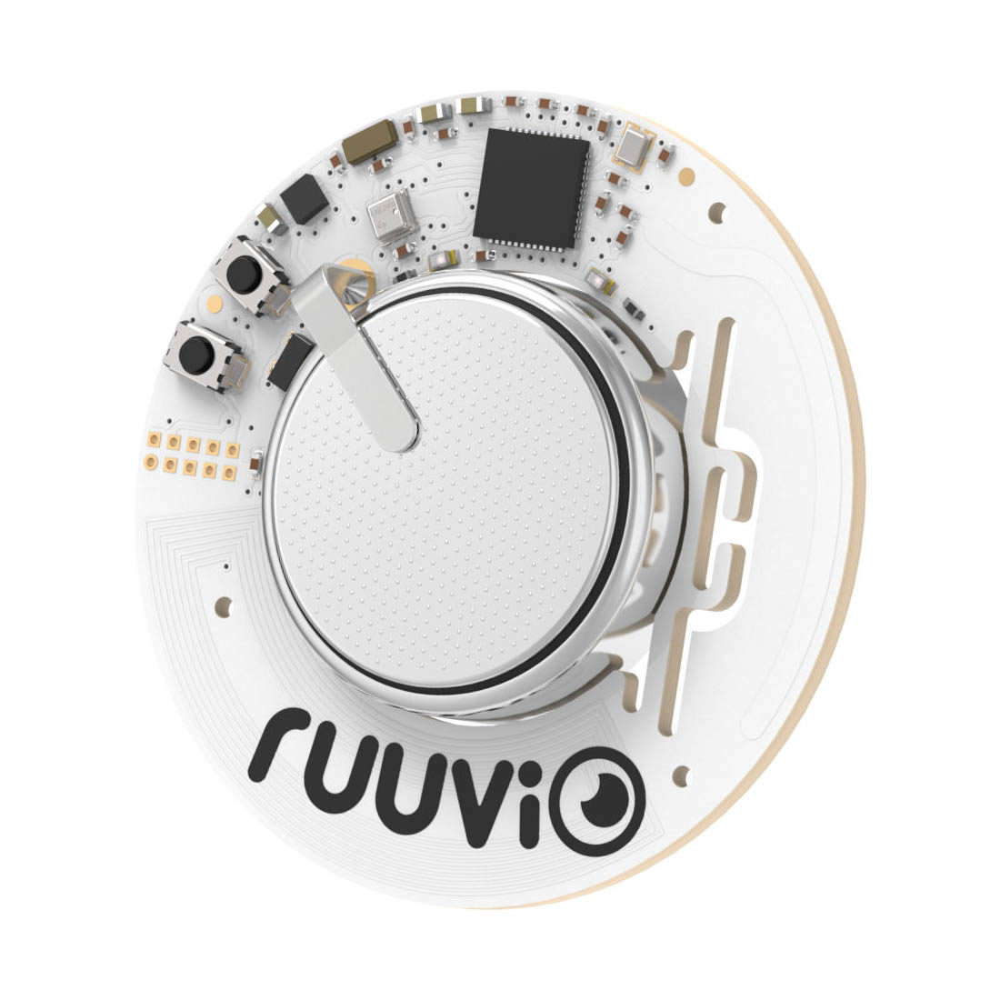

# Ruuvi Station

[![Swift Version][swift-image]][swift-url]
[![License][license-image]][license-url]
[](http://makeapullrequest.com)

Ruuvi Station is an open-source iOS app [available](https://itunes.apple.com/us/app/ruuvi-station/id1384475885) on the AppStore. You can observe environment data read from RuuviTag beacon, such as temperature, humidity, air pressure (and more) right on your iOS device. Ruuvi Station is a companion app for open-source IoT BLE devices made by [Ruuvi](https://ruuvi.com).

<p align="center">
  
  
  
  
</p>

<p align="center">
  <a href="https://itunes.apple.com/us/app/ruuvi-station/id1384475885"></a>
</p>

## RuuviTag

<p align="center">
  <a href="https://shop.ruuvi.com"></a>
  <a href="https://shop.ruuvi.com"></a>
  <a href="https://shop.ruuvi.com"></a>
</p>

[RuuviTag](https://ruuvi.com) is an advanced open-source sensor beacon platform designed to fulfill the needs of business customers, developers, makers, students, and can even be used in your home and as part of your personal endeavours. The device is set up to work as soon as you take it out of its box and is ready to be deployed to where you need it. Whether you need a beehive monitor in your backyard, or an industrial mesh network asset tracking system, [RuuviTag](https://ruuvi.com) gets you covered. 

## Features

- [x] Temperature (°C, °F, K)
- [x] Humidity (%, g/m3, °C)
- [x] Air Pressure (hPa, mmHg, inHg)
- [x] Acceleration (g)
- [x] 10 days sensor data storage
- [x] Charts
- [x] Cloud Features

## Requirements

- iOS 16.0 or later for the app; iOS 17.0 or later for tests.
- Xcode with Swift 6.2 or later. Verification currently uses Xcode 27.2.

## How to use

1. Clone the repo with the recursive parameter  
```zsh
git clone --recursive https://github.com/ruuvi/com.ruuvi.station.ios.git
cd com.ruuvi.station.ios
```

2. Make and open the `Ruuvi.xcodeproj`
```zsh
make
xed Ruuvi.xcodeproj
```

3. Configure Signing
   
4. Build and Run on your device!

<details>
<summary>Optionally</summary>
   
Setup your [Firebase](https://firebase.google.com) project and replace `Apps/RuuviStation/Sources/Resources/Plists/GoogleService-Info.plist`
   
</details>

## Testing

Generate the project before running tests. The `AllTests` scheme includes package, module, app, extension and UI tests:

```zsh
make xcodeproj
xcodebuild -project Ruuvi.xcodeproj -scheme AllTests \
  -destination 'platform=iOS Simulator,name=iPhone 18 Pro' \
  -enableCodeCoverage YES -resultBundlePath /tmp/RuuviTests.xcresult test \
  CODE_SIGN_IDENTITY=- CODE_SIGNING_ALLOWED=YES
python3 scripts/test/coverage.py /tmp/RuuviTests.xcresult \
  --output /tmp/RuuviCoverage.json
```

For a complete verification, boot the simulator and use a new output directory:

```zsh
python3 scripts/test/verify.py --device 'iPhone 18 Pro' \
  --output /tmp/RuuviVerification
```

This generates resources, builds every Swift package product and test target,
runs the full simulator suite, and exports coverage and screenshots. Use
`--minimum-coverage 95` to enforce a per-target coverage threshold.
Reports retain every first-party target, including targets with no executable lines.
The UI navigation checks preserve saved simulator sensors; the existing-sensor
check needs at least one saved sensor.

## Get in touch

Join our [Slack](https://slack.ruuvi.com) community. Feel free to ask ``@muzibur`` about iOS code.  

Join our [Telegram](https://t.me/ruuvicom) community. Feel free to ask ``@ipriyo`` about iOS code. 

## How to buy

You can order RuuviTag sensors [online](https://shop.ruuvi.com). Find more info about the devices on [Ruuvi.com](https://ruuvi.com). 

## Contribute

We would love you for the contribution to **Ruuvi Station**, check the ``LICENSE`` file for more info.

## Branches

Development source code is available at `main` branch.  
AppStore, Testflight build source code is available at associate release branches i.e. `release/x.x.x` branch. 

<!-- Please don't remove this: Grab your social icons from https://github.com/carlsednaoui/gitsocial -->

[![Twitter][twitter-image]][twitter]
[![Facebook][facebook-image]][facebook]
[![Github][github-image]][github]

[github-image]:http://i.imgur.com/0o48UoR.png
[github]:https://github.com/ruuvi
[facebook-image]:http://i.imgur.com/P3YfQoD.png
[facebook]:https://www.facebook.com/ruuvi.cc/
[twitter-image]:http://i.imgur.com/tXSoThF.png
[twitter]:https://twitter.com/ruuvicom
[swift-image]:https://img.shields.io/badge/swift-6.2-orange.svg
[swift-url]: https://swift.org/
[license-image]: https://img.shields.io/badge/License-BSD-blue.svg
[license-url]: LICENSE
